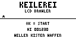
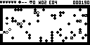
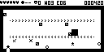
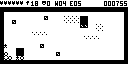

# KEILEREI – LCD Brawler for Flipper Zero

A tiny dot-matrix beat-'em-up in the style of old LCD handhelds (Brick Game, Snake), built for the 128×64 Flipper screen.

 
 

## Gameplay
- Fight through **enemy waves**: Grunt, Runner, Brute, Shooter and a **Boss** every 5th wave.
- Smash **crates** to find weapons: **Club** (knockback), **Sword** (3-cell arc), **Axe** (range 2, heavy), **Pistol** (12 rounds), **Shield** (blocks 5 hits), **Heart** (+2 HP). Weapons wear out.
- The **arena changes** every wave: Factory Hall, Forest (cut the bushes), Conveyor Belts (they push you), Kiln (pulsing lava), Ice Storage (you slide), Night Shift (light cone only).
- After wave 10 the cycle repeats harder.

## Controls
| Button | Action |
|---|---|
| D-pad | Move |
| OK | Attack / shoot (hold = auto) |
| Back (short) | Pause (on title: exit) |
| Back (long) | Exit |

## Build
```
pip install ufbt
ufbt            # builds dist/keilerei.fap
ufbt launch     # build, install via USB and start
```

## Architecture
- `fight_core.c/.h` – platform-independent game core (plain C99, no dependencies). Renders into a 1 KB 1-bit framebuffer in XBM format.
- `fight_app.c` – Flipper glue (input, 20 Hz timer, sound/vibration, high score).
- `web/index.html` – the same game for browser/Android. Logic is bit-for-bit identical to the C core.

All wave, enemy and weapon values are in the configuration block at the top of `fight_core.c`.

## Privacy
No network access, no tracking. The only data stored is the high score on the SD card (`/ext/apps_data/keilerei/hiscore.bin`).

## License
MIT – see [LICENSE](LICENSE).
